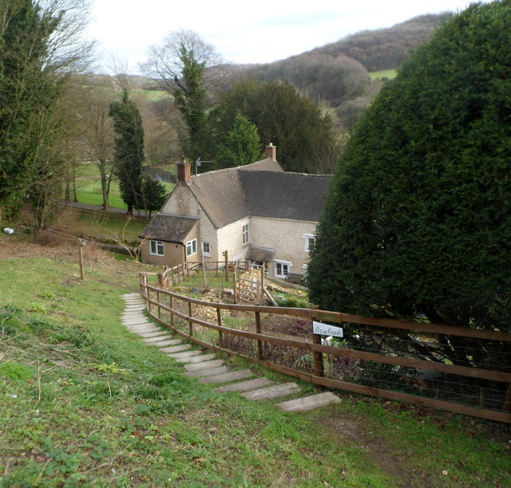

# Лори Ли: личность между памятью, домом и дорогой

**Предварительный документальный разбор.** Девять осей; в каждой отдельно отмечены документированное, осторожный вывод и то, что остаётся спорным. Это не клинический портрет и не окончательное толкование произведений.

*Слэд — реальное место, но не «застывшая декорация»: фотография 2006 года, не изображение деревни времён детства Ли. Полная атрибуция — в [analysis/credits.md](credits.md).*

## Краткий вывод

По биографии Валери Гроув Лори Ли предстаёт не человеком с одной объясняющей чертой, а сочетанием взаимно напряжённых качеств: он зависел от домашней и женской поддержки, но ценил одиночество; уходил из родного места, а затем вложил в него литературную и материальную жизнь; внимательно слушал людей и одновременно умел редактировать, уплотнять и перестраивать память; был поэтом, которого публика прежде всего запомнила как прозаика. Это выводы о возможных закономерностях, а не доказанные психологические причины.

**Граница источника.** Главный источник — биография Гроув, основанная на письмах, дневниках, архивных бумагах и свидетельствах близких. «Документировано» ниже означает «Гроув приводит такой документ или приписывает такое воспоминание конкретному свидетелю», а не то, что каждый эпизод независимо подтверждён несколькими источниками. Нумерация ссылок вида «PDF p. 15» — страница локального 541-страничного PDF, не печатная пагинация книги.

**Книги Ли в репозитории отсутствуют.** Поэтому здесь нет близкого чтения «Сидра с Рози», «Как я вышел однажды летним утром», «Розы для зимы», «Мгновения войны» или стихотворных сборников. О книгах говорится лишь там, где это необходимо для биографического контекста; такая часть основана на пересказе и цитатах Гроув и прямо так обозначена. Книга Валери Гроув не заменяет первичный текст Ли.

### Что уже даёт локальный архив

Гроув описывает Слэд начала XX века как бедную долину с плотной общинной жизнью, без водопровода, электричества и регулярного автобуса до 1924 года. Ли рос среди разговоров, церковных и деревенских представлений, музыки и рассказов соседей; его ранняя тетрадь, школьные наблюдения и дневниковые списки показывают привычку замечать мелочи. В четырнадцать лет он играл на танцах, а его трио получало гонорар; в 1933-м его стихотворение появилось в местной газете, затем — в национальной «Санди Рефери». Это позволяет говорить о ранней среде и практике без домыслов о книгах, которых у нас нет. [Grove, PDF pp. 21–25, 37, 49]

## Девять осей

### 1. Отсутствие отца и «дом женщин»

#### Документировано

Когда Ли было три года, семья переехала в Слэд. Во время Первой мировой отец, Реджинальд, ушёл на службу; после войны он устроился в гражданскую службу, редко бывал дома и присылал деньги. В доме Энни, Лори, Джека и нескольких детей от первого брака отца было тесно: Лори и Джек делили чердак с тремя старшими сёстрами от первого брака отца. Гроув также приводит письмо Энни, где та напоминает, что Редж терпеливо помогал ей ухаживать за тяжело больным младенцем Лори. [Grove, PDF pp. 14–16]

#### Что из этого следует

Можно предположить, что повседневное чувство дома формировалось прежде всего через Энни, сестёр и женщин деревни. Однако сам факт «женского дома» — это описание бытовой среды, а не доказательство того, что вся дальнейшая эмоциональная жизнь Ли была предопределена отцовским отсутствием. Присутствие отца в отдельных важных эпизодах делает простую формулу «отца не было» неточной.

#### Что остаётся спорным

Взрослый Ли описывал отца крайне резко, а Гроув приводит и голос Энни, и семейные воспоминания. По одним только поздним оценкам нельзя восстановить детское переживание целиком. Ни дом, полный женщин, ни редкие визиты отца сами по себе не позволяют поставить диагноз или свести отношения Ли с женщинами к одной причине.

### 2. Мать Энни как способ любить

#### Документировано

Гроув описывает Энни как щедрую, любознательную и музыкальную, но неустроенную в быту и деньгах. Она приучала детей к книгам, песням и рассказам, интересовалась соседями и годами посылала Лори письма с деталями о Слэде. В эпизоде окончания Первой мировой Ли вспоминал, что мать отсутствовала дома; Энни ответила ему письмом: она уехала к заболевшему брату и оказалась в Лондоне в день перемирия. Это два свидетельства об одном дне, но из разных перспектив. [Grove, PDF pp. 16–20]

#### Что из этого следует

Энни могла передавать любовь не через идеальный домашний порядок, а через внимание, истории, чтение, музыку и обмен письмами. В этой семейной истории тепло не отменяет бытовой нестабильности, а близость не устраняет детскую обиду. Для будущего рассказчика мать была и источником материала, и человеком со своей версией жизни.

#### Что остаётся спорным

Нельзя решить, что один рассказ «правильный», а другой «ложный»: ребёнок мог пережить отсутствие как оставленность, а мать могла уехать по серьёзной причине. Нет и оснований считать Энни ни безупречной святой, ни виновницей всех трудностей сына. Поскольку текст «Сидра с Рози» здесь недоступен, нельзя утверждать, как именно мемуар меняет или идеализирует Энни: это требует чтения самой книги.

### 3. Уход и возвращение: ушёл в двадцать, купил дом в Слэде

#### Документировано

В июне 1934 года, незадолго до двадцатилетия, Ли ушёл из Слэда с палаткой и скрипкой. Первой целью был Лондон, а не Испания. В 1959 году он вернулся в деревню после успеха «Сидра с Рози»; затем купил землю, а в 1961-м вместе с Кэти поселился в Rose Cottage, в нескольких шагах от местного паба. Это был не дом его детства. Гроув фиксирует его чувство, будто он наконец «бросил якорь», но также постоянные поездки и жизнь между Слэдом и Лондоном. [Grove, PDF pp. 45, 277–278, 300–304]

*Современный снимок тропы к Rosebank. Он обозначает географическую близость, но не является фотографией дома Ли или реконструкцией 1930-х. Атрибуция и лицензия — в [analysis/credits.md](credits.md).*

#### Что из этого следует

Возвращение можно понимать не как отмену странствий, а как новую форму привязанности. Ли вернулся уже не только сыном Энни, но и известным автором, чьё описание деревни изменило отношение местных к собственным историям. Слэд стал одновременно местом жизни, материалом для письма и частью публичного образа.

#### Что остаётся спорным

Фраза «вернулся домой» слишком легко превращает сложную жизнь в завершённую дугу. Купленный дом отличался от родительского, а Ли продолжал ездить и нуждался в уединении. Был ли дом первичной мечтой или символом, усилившимся после успеха, биография не доказывает. Для такого вывода важны сами тексты и авторские версии возвращения.

### 4. Женщины, которые давали больше, чем получали?

#### Документировано

В биографии видна целая сеть женщин. Молли Смарт читала ранние стихи и критиковала их; Бетти поддерживала Ли и убеждала его не застревать в конторе. Уилма Грегори помогала ему материально и добивалась его возвращения из Испании — это подтверждает и архивная заметка Британской библиотеки. Лорна Уишарт была возлюбленной и важным литературным вдохновением. Кэти стала женой и соавтором повседневной жизни в Rose Cottage. Гроув отмечает, что публичное поминовение Ли после смерти было организовано мужчинами, несмотря на центральную роль женщин в его биографии. [Grove, PDF pp. 11–12, 35–44, 112–118, 217–238; British Library, 2014]

#### Что из этого следует

Талант Ли не возник в вакууме: рядом были читательницы, редакторы, наставницы, возлюбленные и родственницы, которые давали время, деньги, критику и эмоциональную опору. Такое наблюдение корректирует образ одиночного гения и возвращает в рассказ женский труд, который позднейшая слава могла заслонить.

#### Что остаётся спорным

Формула «женщины давали больше, чем получали» — интерпретация, а не измеримый факт. Женщины в источниках действуют и выбирают сами; отношения включали и взаимность, и конфликт, и неравенство. Биографический архив не даёт полного доступа к их внутренней жизни. Нужны сами письма женщин и тексты Ли, чтобы проверить, как поддержка превращалась в литературный материал и как он признавал эту поддержку.

### 5. Поэт, которого мир сделал прозаиком

#### Документировано

Ли публиковал стихи в местной газете, а затем в национальной «Санди Рефери»; до этого играл на деревенских танцах и не имел единственной заранее выбранной карьеры. В 1959 году «Сидр с Рози» неожиданно стал бестселлером. Гроув замечает изменение публичного ярлыка: сначала Ли был поэтом, написавшим книгу, а позже — прозаиком, который прежде писал стихи. Сам Ли говорил, что без финансовой свободы от прозы он, вероятно, не смог бы написать свои книги. [Grove, PDF pp. 24–25, 37, 49, 290, 293, 307]

#### Что из этого следует

Успех прозы поменял экономику авторской жизни и ожидания читателей. Но это не означает, что поэт исчез: ритм, метафорическое мышление и внимание к звуку могли перейти в прозу. Здесь точнее говорить о смене публичного жанрового образа, а не о превращении одного человека в другого.

#### Что остаётся спорным

Выражение «мир сделал его прозаиком» упрощает причинность. Свою роль сыграли рынок и аудитория, но Ли сам выбирал мемуары, эссе и поздние книги. Не следует утверждать, что он перестал быть поэтом или внутренне отверг стихи. Проверить соотношение поэтического и прозаического голоса можно только через первичные тексты; их пока нет.

### 6. Память как материал: иск 1960 года и спор о «Мгновении войны»

#### Документировано

В 1960 году рассказ о пожаре на фортепианной фабрике привёл к иску о клевете. По Гроув, суд признал этот эпизод вымышленным; в поздних изданиях «фортепианную фабрику» заменили «котельной», а спорная фраза исчезла. В случае «Мгновения войны» проблема иная: Ли опубликовал книгу в 1991 году, более чем через пятьдесят лет после испанских событий, а дневники 1930-х были украдены в 1969-м. Гроув приводит критику ветеранов Билла Александера и Джона Данлопа, указывает на несостыковки, но не отменяет всех свидетельств о пребывании Ли в Испании. [Grove, PDF pp. 33, 283–284, 290–291, 407–415]

Позднее Британская библиотека сообщила о найденном дневнике 1936–1937 годов и документальном подтверждении членства Ли в Интернациональных бригадах. Найденный дневник заканчивается до возвращения Ли на войну и не разрешает главные споры о событиях зимы 1937–1938-го. Есть и разница в подсчёте срока: Гроув говорит о девяти неделях, Британская библиотека — об одиннадцати. [British Library, 2014]

#### Что из этого следует

История с иском показывает, что память и литературная реконструкция могут причинить конкретный вред, если читатель узнаёт в персонаже реального человека. Спор о войне показывает другое: атмосферная или эмоциональная правда не тождественна точности маршрута, дат и эпизодов. Достоверность лучше проверять на уровне отдельных утверждений, а не объявлять целиком истинной или ложной.

#### Что остаётся спорным

Не установлены все обстоятельства испанского эпизода, точная последовательность событий и степень художественного восстановления памяти. Ветеранская критика, архивные документы и поздний дневник освещают разные части вопроса. Без текста «Мгновения войны» здесь можно пересказать спор по Гроув и Британской библиотеке, но нельзя оценить, как сама книга строит сцену и сигнализирует о границах памяти.

### 7. Джек: почти четверть века молчания

#### Документировано

Братья Джек и Лори были близки в детстве, но учились в разных школах; Джек считал это одним из первых источников отдаления. Позднее они встретились в Австралии после долгого перерыва, затем ещё раз в Слэде. После этого Лори не разговаривал с Джеком до конца жизни. Джек сожалел об отчуждении. Гроув приводит версию Кэти, связывавшую разрыв с картиной Генри Мура, но подчёркивает, что точную причину не знал никто. [Grove, PDF pp. 23–24, 357–358]

#### Что из этого следует

Молчание — важный документированный факт отношений, но не ключ, автоматически объясняющий личность Ли. Оно может говорить о способности резко ограничивать контакт или о конфликте, который обе стороны не смогли разрешить. Без прямых свидетельств это не больше чем осторожная гипотеза.

#### Что остаётся спорным

«Двадцать пять лет» — округлённый срок: Гроув говорит, что после второй встречи Ли не говорил с братом до смерти, но не датирует последний разговор с точностью, позволяющей посчитать каждый год. Неясны повод, распределение ответственности и характер контактов между братьями. Версия о картине — семейное предположение, а не установленная причина.

### 8. Зимние состояния и недоверие к себе

#### Документировано

У Ли была эпилепсия; Гроув допускает связь с ударом при велосипедной аварии в детстве, но формулирует её как возможность, не как доказанную причину. Дневники и письма фиксируют мрачные настроения, неудовлетворённость работой и сомнения в собственном таланте. Кэти описывала период, когда лекарства, подавленность и алкоголь складывались в разрушительный круг. В поздних заметках Ли прямо видны страх потерять контроль и сомнение в том, способен ли он ещё писать. [Grove, PDF pp. 29, 33–34, 39, 353–357, 411]

#### Что из этого следует

«Зимние состояния» можно использовать как метафору повторяющихся периодов уязвимости, а не как медицинское название. Они могли влиять на рабочий ритм и самооценку, но не отменяют юмор, общительность и периоды творческой активности, которые тоже описывает Гроув.

#### Что остаётся спорным

Источники не позволяют установить точные границы между эпилепсией, лечением, алкоголем, депрессией и творческим кризисом. Нельзя задним числом поставить Ли психологический диагноз или объяснить им все его решения. Для этого понадобились бы медицинские документы и более прямые свидетельства, которых у нас нет.

### 9. Умение слушать как основа прозы

#### Документировано

Ещё в детстве Ли вёл списки, записывал наблюдения и описывал местную природу. Вернувшись в Слэд, он наполнял блокноты разговорами в пабах, деревенскими словами и историями соседей. Друзья поздних лет характеризовали его как внимательного слушателя; критики слышали в прозе голоса и разговорные интонации. Это подтверждает интерес к практике наблюдения, но не доказывает, что его записи были дословной стенограммой. [Grove, PDF pp. 22–25, 277–278, 394]

#### Что из этого следует

Правдоподобна гипотеза, что Ли сначала собирал интонации, жесты, запахи и оговорки, а затем превращал услышанное в литературный ритм. В таком случае слушание — не просто черта характера, а рабочий метод писателя: материалом становились не только пейзажи, но и чужая речь.

#### Что остаётся спорным

Записная книжка уже отбирает и организует; память и редактура меняют услышанное. Литературный эффект достоверного голоса не равен полной точности записи. Проверить это можно лишь на самих книгах, сравнивая страницы мемуаров с письмами, дневниками и свидетельствами. До получения текстов вывод остаётся биографической гипотезой.

## Книги и фрагменты, нужные для следующего шага

Пришлите, пожалуйста, сами тексты или фрагменты с номерами страниц. Приоритет — книги, без которых невозможно перейти от биографии к проверяемому чтению произведений:

1. **Cider with Rosie / «Сидр с Рози»** (1959; американское издание — *The Edge of Day*) — детство, Энни, устройство памяти и образ деревни.
2. **As I Walked Out One Midsummer Morning / «Как я вышел однажды летним утром»** (1969) — уход, странствие, ранняя Испания и авторская персона.
3. **A Moment of War / «Мгновение войны»** (1991) — испанский эпизод и спор между памятью, документом и литературным повествованием.
4. **A Rose for Winter / «Роза для зимы»** (1955) — поездка по Испании с Кэти и самопредставление автора.
5. **Стихи:** *The Sun My Monument* (1944), *The Bloom of Candles* (1947), *My Many-Coated Man* (1955) или доступный сборник избранного — для сравнения поэта и прозаика.

Полезно дополнительно: **The Firstborn** (1964) — авторская перспектива на рождение ребёнка и отцовство; **I Can’t Stay Long** (1975) — эссе и путевые тексты. Можно прислать книги целиком или начать с глав об Энни, уходе, Испании, Кэти и стихах, а также спорные эпизоды о памяти. Достаточно нескольких глав с точными страницами. В ответном разборе я отделю прямые наблюдения над текстом Ли от сведений, полученных через Гроув и другие источники; длинные фрагменты книг в сценарий и PDF включать не буду.

## Источники и границы уверенности

- Valerie Grove, *The Life and Loves of Laurie Lee*. Локальный PDF в репозитории, 541 страница. Номера страниц в тексте отчёта — номера страниц PDF.
- British Library, “Laurie Lee’s lost diary discovered” (17 April 2014): найденный дневник 1936–1937 годов, архивное подтверждение службы в Интернациональных бригадах и разница в подсчёте срока пребывания в Испании. [Онлайн-страница](https://blogs.bl.uk/english-and-drama/2014/04/laurie-lees-lost-diary-discovered.html).
- Фотоисточники и лицензии перечислены отдельно: [analysis/credits.md](credits.md).

Этот разбор не является диагнозом и не претендует на окончательное объяснение Ли. Он строит проверяемые гипотезы из биографии, отмечая, где именно заканчивается документ и начинается интерпретация.

## Иллюстрации и лицензии

- Ian Hunter, *Slad Village*, вид на Слэд с дороги на Страуд (2006). Источник: [Wikimedia Commons](https://commons.wikimedia.org/wiki/File:Slad_Village_-_geograph.org.uk_-_759427.jpg); лицензия [CC BY-SA 2.0](https://creativecommons.org/licenses/by-sa/2.0/).
- Jaggery, *Steps down to Rosebank, Slad* (2012). Источник: [Wikimedia Commons](https://commons.wikimedia.org/wiki/File:Steps_down_to_Rosebank,_Slad_-_geograph.org.uk_-_2788147.jpg); лицензия [CC BY-SA 2.0](https://creativecommons.org/licenses/by-sa/2.0/).

Обе фотографии — современные виды, не исторические изображения детства Ли; в PDF они пропорционально уменьшены без кадрирования и фильтров. Полные требования атрибуции и ссылки на исходные фотографии приведены в [analysis/credits.md](credits.md).